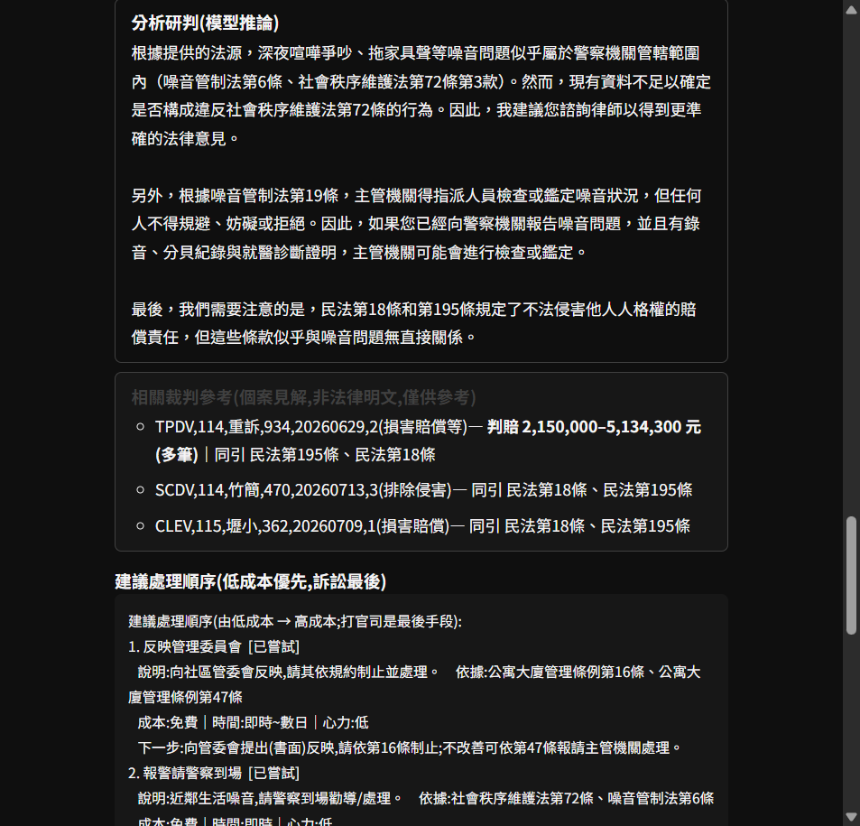

# Legal Agent

[](https://github.com/0Smallcat0/legal-agent/actions/workflows/ci.yml)
[](LICENSE)
[](https://huggingface.co/spaces/NoirOAO/legal-agent-demo)

**花錢請律師之前，先把自己的處境搞懂。** 用平常講話的方式說出你遇到的事——押金不退、
車禍賠償、加班費沒給、樓上太吵——回答幾個問題，就會看到：

- **適用的法條原文和白話說明。** 每一條引用都由程式拿官方條文查核過，查不到或引錯的會標出來。
- **從不花錢到上法院的處理步驟。** 寄存證信函（附範本，法條逐字引用）、申請免費調解，最後才是
  訴訟；你說了金額，它會算出該走小額、簡易還是通常程序，裁判費大約多少。
- **引用相同法條的法院判決。** 法院最後怎麼判、判賠多少，摘自判決主文。

**[直接在瀏覽器用](https://huggingface.co/spaces/NoirOAO/legal-agent-demo)**——免費、不用註冊。

涵蓋 18 部民生法規（民法、勞動基準法、租賃住宅市場發展及管理條例、消費者保護法、公寓大廈管理
條例、道路交通管理處罰條例等）共 3,758 條現行條文，和 435 則法院判決。資料庫沒有涵蓋的問題，
它會直接說不知道，不會硬答。**這是參考工具，不是法律意見，也不能取代律師。**

<p align="center">
  
</p>

### 在自己的電腦上用

需要 [Python 3.10 以上](https://www.python.org/downloads/)。在終端機一行一行執行：

```bash
git clone https://github.com/0Smallcat0/legal-agent.git
cd legal-agent
python -m pip install ".[demo]"
python app.py
```

再用瀏覽器打開終端機印出的網址（通常是 http://127.0.0.1:7860）。不需要帳號、金鑰或顯示卡：
法條、處理步驟和判決都由程式產生。只有「分析研判」那一段要用語言模型——裝好
[Ollama](https://ollama.com) 後執行 `ollama pull llama3.1`，重新開啟程式就有。

**答錯了？** 用[回報表單](https://github.com/0Smallcat0/legal-agent/issues/new?template=wrong-answer.yml)
貼上你當時輸入的原話和它的回答。這是讓它變準最有用的資料；表單是公開的，不要貼個資。

---

## For engineers: a RAG pipeline where every citation is checked by code

The checker is itself graded, by planting errors into correct answers and
counting what it catches.

The usual defence against a hallucinated citation is a better prompt. Here it is
a separate program that runs after the model and compares each citation with the
source corpus: does the article exist, does the quote match, was it in force on
that date. Everything that must be right — retrieval, the citation check, the
confidence tier, the deadlines quoted — is decided by code; the model only
writes the prose, and the whole pipeline also runs with no model at all.

The [demo](https://huggingface.co/spaces/NoirOAO/legal-agent-demo)'s 引用查核 tab
ships a pre-filled broken answer; checking it takes thirty seconds. The checker
on its own:

```bash
python -m pip install "git+https://github.com/0Smallcat0/legal-agent.git"
```

```python
import legal_agent

for r in legal_agent.verify("依社會秩序維護法第72條,深夜喧嘩可處新臺幣六萬元以下罰鍰。"):
    print(r.flagged, r.reason)
# True  主張金額 [60000] 元未見於條文(條文金額 [10000])
```

No torch, GPU, key or model: the database builds itself from the packaged corpus
on first call. `as_of="2024-06-01"` checks the law as it stood that day. The
corpus and the 435 judgments are all in the repo, so a fresh clone reproduces
every number below.

### Four numbers, and what each does not say

| | measured | what it does NOT say |
|---|---|---|
| **The checker** — errors planted into correct answers, across the whole corpus | **100% caught in each of 24 kinds, 0/3,758 false positives** | Green means the article exists, is in force and was not misquoted. It never meant the article governs your problem. |
| **Against the bare model** — the same model with and without the pipeline | citations a reader would have to take on trust: **67% → 5%** (llama3.1, golden set) | The gated delta sits inside the harness's run-to-run spread; the 67% reproduces. qwen2.5:7b, one sample: 33% of bare citations untraceable and 13% naming a law that does not exist, against 2.9% flagged once gated. Not measured against a frontier model. |
| **On disputes it has never seen** — government case tables, governing article taken from the authority's own 法令依據 column, never tuned against | right article in the window **12/23**; answer points the opposite way to the recorded outcome **3/16** | On the case table it was tuned against, the same measure reads 25/27. 12/23 is the honest figure for new territory. |
| **Catching those wrong-way answers** — 5 blind-coded inversions vs 11 agreements, checker never sees the outcome | four local LLM judges (Prometheus 2, JudgeLM, Qwen2.5, Llama3.1): **0/5 caught, or 3–5/5 only by also flagging 8–11 of the 11 right answers**. No-model 主文/理由 direction-word check: **2/5 caught, 1/11 false** | Neither ships. The word check's split is within chance at this size (one-sided p = 0.21), and what it catches is the model mislabelling 對方, not wrong law. Nothing here catches a wrong-way answer yet. |

Every other number — retrieval recall 349/356 on 168 stored sessions written in
everyday wording, honesty and refusal rates, the reference-judgment acceptance
set (87% of judgments shown are ones the question should cite, 84% held out) —
is in [`evals/RESULTS.md` §1](evals/RESULTS.md), each with the harness that
produces it and the ones that went down. Retrieval reaches 349/356 only with the
optional bge-m3 index (`ollama pull bge-m3`, then
`python -m legal_agent.retrieval.dense`); a plain install is lexical only and
reads 321/356.

<sub>In the screenshot above, the 8B model calls 民法§18/§195 irrelevant; right
below it, three real judgments decided under those very articles, the award read
verbatim from the 主文. The weakest part is the model; the parts that must be
right are not left to it.</sub>

### Three things you can lift

- **[citation verifier](legal_agent/anti_hallucination/verifier.py)** — pure code,
  no model: extracts citations from generated text and checks existence, content
  and in-force date against the corpus.
- **[mutation-tested guardrails](legal_agent/evaluation/mutation.py)** — grades
  the verifier by seeding defects, so the safety net has a measured catch rate.
- **[time-sliced retrieval](legal_agent/retrieval/retriever.py)** — filters by
  point-in-time validity *before* ranking, so a repealed version cannot be
  retrieved and then explained away.

### More

[RESULTS.md](evals/RESULTS.md) every number, its harness, and the ones that went
down · [SPEC.md](SPEC.md) design · [CONTRIBUTING.md](CONTRIBUTING.md) the bar a
change has to clear · [AGENTS.md](AGENTS.md) the same plus the measurement traps ·
[DEPLOY_SPACES.md](docs/DEPLOY_SPACES.md) hosting · [CHANGELOG.md](CHANGELOG.md)
what changed

```bash
python -m legal_agent.evaluation.mutation                # the checker's catch rate
python -m legal_agent.evaluation.realworld --direction   # disputes it has never seen
```

Personal project, **not legal advice**. [MIT](LICENSE).
